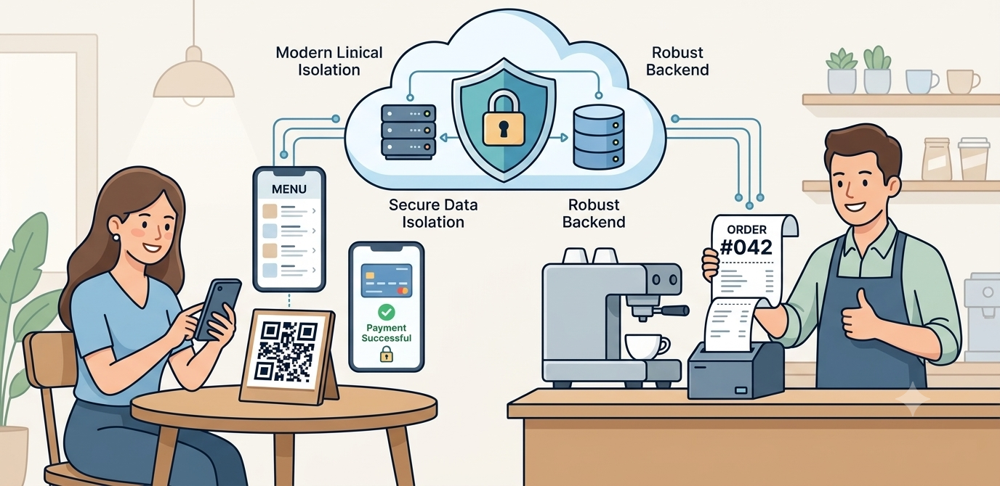

# AniVero

## Proyecto personal

Una plataforma **SaaS modular multi-tenant** para negocios locales, empezando por hostelería.

**[Ver caso de proyecto: AniVero](./CASO-DE-PROYECTO.md)**

[Probar la demostración](https://www.anivero.es/m/demo)

La demo permite consultar la carta, seleccionar productos y completar un pedido simulado. No procesa pagos ni envía pedidos reales.

---

## Problema

Los negocios locales necesitan herramientas digitales simples, pero los SaaS del mercado suelen ser genéricos, caros o difíciles de adaptar. AniVero propone una plataforma modular donde cada negocio activa solo lo que necesita.

## Stack

- **Next.js + TypeScript** (frontend)
- **Supabase** (backend, Auth, Edge Functions)
- **PostgreSQL** con Row Level Security
- **Stripe Connect** (pagos)
- **Resend** (alertas)
- **pgTAP + Deno test** (testing)

## Testing

El proyecto se verifica con evidencia, no solo con revisión manual:

- **122 assertions pgTAP** sobre aislamiento de tenants, RLS, catálogo público e integridad de pedidos/pagos.
- **30 tests Deno** sobre las Edge Functions de pago y webhook.

## Estado actual

**Backend / MVP:** núcleo multi-tenant, catálogo público, pedidos anónimos, pagos e integridad, webhook de Stripe y suite de tests — completos.
